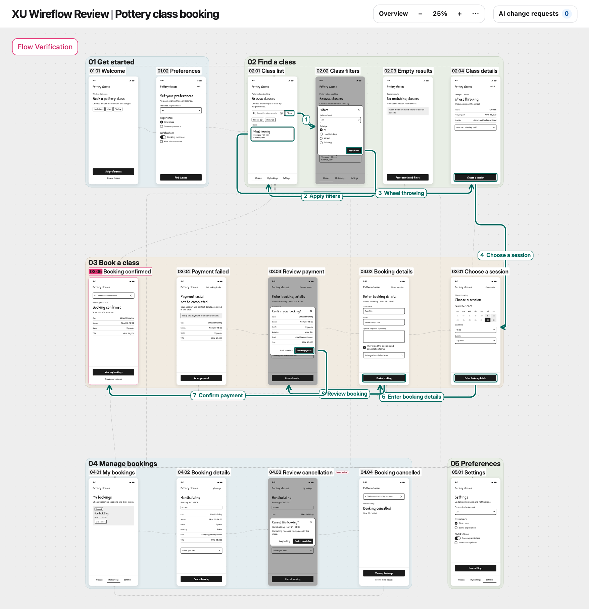
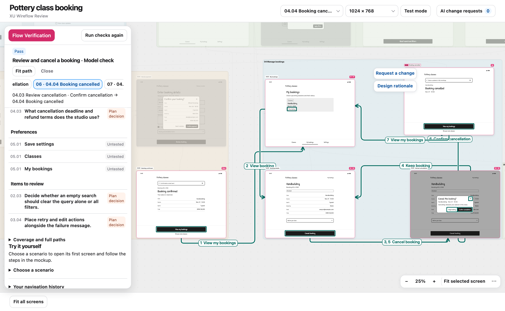

# XU Wireflow Review

[English](README.md) · 한국어

앱을 기획하는 누구나 **화면 구조와 사용자 흐름**을 점검할 수 있는 AI 스킬입니다. 기획 메모나 기존 화면을 바탕으로 단순한 더미 화면들을 화살표로 연결한 와이어플로우를 만듭니다. 시각 디자인을 정하기 전에 버튼을 직접 눌러 보며 화면이 자연스럽게 이어지는지, 빠진 단계는 없는지 확인하세요.

- **앱 전체를 한눈에 봅니다.** 화면을 기능별로 모아 보여줍니다. 경로 하나를 고르면 눌러야 할 버튼과 다음 화면을 잇는 화살표가 순서대로 강조됩니다.
- **놓치기 쉬운 동작을 확인합니다.** 입력 후 뒤로 가거나, 중간에 취소하거나, 실패 후 다시 시도해 보세요. 어느 화면으로 돌아가고 어떤 값이 남는지 확인할 수 있습니다.
- **고칠 내용을 AI에 정확히 전달합니다.** 보고 있는 화면에서 수정 요청을 복사하세요. 기획에 꼭 필요한 동작, AI가 제안한 화면, 아직 결정할 질문이 복사문에도 구분되어 남습니다.

## 내 프로젝트에 적용하기

1. AI 코딩 도구에서 프로젝트를 여세요. 짧은 기획 메모나 기존 화면으로 시작할 수 있습니다.
2. 프로젝트 채팅에 아래 두 줄을 붙여 넣으세요. 비공개 검증 기간에는 AI 도구에 이 저장소를 읽을 수 있는 GitHub 계정이 연결되어 있어야 합니다.

```text
https://github.com/JeongK7998/wireflow-review
이 스킬을 내 프로젝트에 적용해줘.
```

3. AI가 만든 HTML 파일을 브라우저에서 여세요. 사용자가 끝내야 할 일 하나를 고르고 강조된 화살표를 따라가 보세요. 어색한 단계가 있으면 해당 화면에서 수정 요청을 복사해 같은 채팅에 붙여 넣으세요.

## 화면에서 살펴보기

**모바일 · 앱 전체에서 한 경로 따라가기.** 번호가 붙은 화살표를 따라가면 어떤 버튼을 눌러 다음 화면으로 가는지 보입니다. 검색 결과가 없거나 작업에 실패하는 화면도 같은 지도에서 찾을 수 있습니다.

[](release/media/booking-mobile-en.png)

**태블릿 · 두 선택의 결과 비교하기.** 확인창을 닫을 때와 선택을 확정할 때 각각 어디에 도착하는지 살펴보세요. 옆의 검증 패널에서 현재 단계와 아직 정해야 할 질문을 함께 볼 수 있습니다.

[](release/media/booking-tablet-en.png)

내 프로젝트에 적용하기 전에 직접 눌러 보려면 예제를 내려받아 브라우저에서 여세요. [한국어 예제 내려받기](release/example/pottery-booking.ko.html?raw=1)

저장소 링크를 받은 AI는 프로젝트 적용 안내를 따릅니다. [프로젝트 적용 안내](release/APPLY.md#한국어) · [스킬 ZIP 내려받기](release/wireflow-review-v0.5.3.zip?raw=1)
