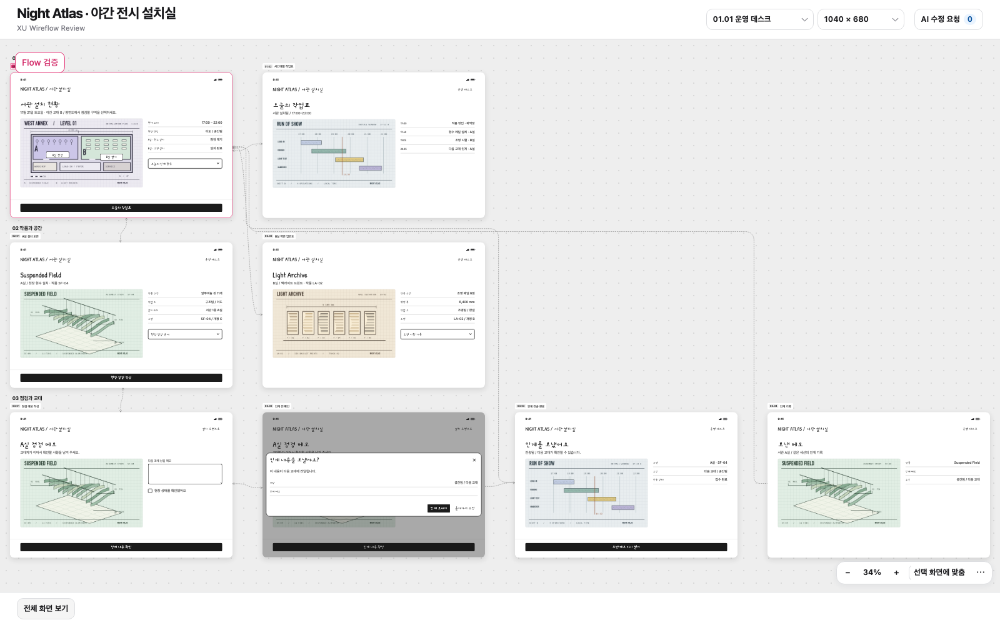
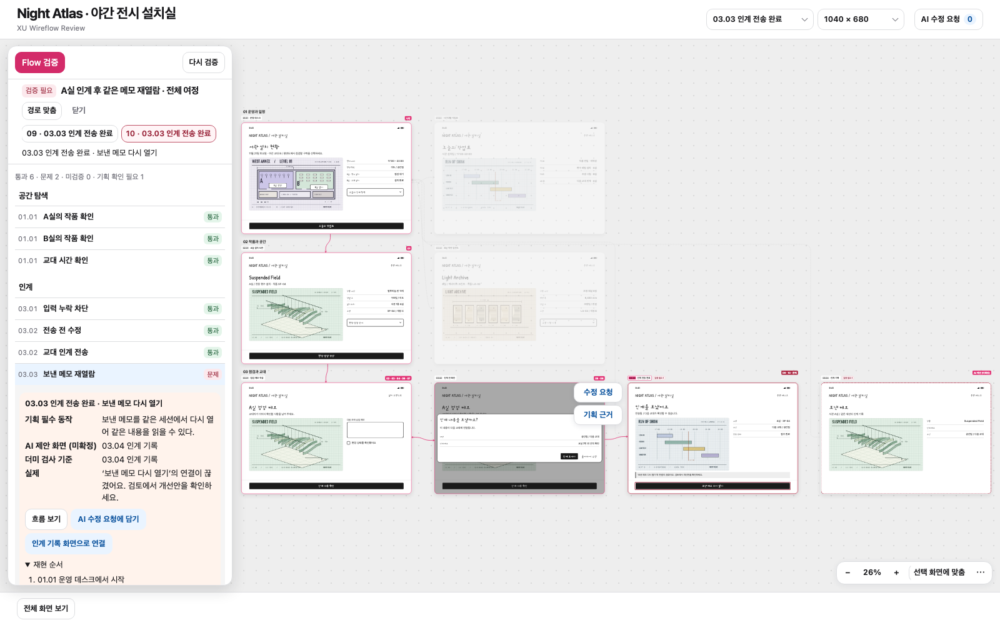

# XU Wireflow Review

바이브 코딩으로 앱을 기획하는 디자이너가 화면을 직접 눌러 보며 빠진 동작과 아직 결정할 일을 찾도록 돕는 스킬입니다.

[](release/media/01-canvas.png)

전시 운영 앱 Night Atlas의 전체 흐름입니다. 평면도에서 A실을 골라 도면을 확인하고, 다음 교대에 메모를 보내는 경로를 따라가 보세요.

[클릭 예제 HTML 내려받기](release/example/night-atlas.html?raw=1) · [실제 조작 영상](release/media/night-atlas.mp4)

## 흐름을 따라가며 발견한 문제

[](release/media/04-review.png)

메모는 전송되지만 **‘보낸 메모 다시 열기’**를 누르면 길이 끊깁니다. 보낸 내용을 다시 읽을 수 있어야 한다는 건 기획에 있습니다. 별도 인계 기록 화면을 만들지는 디자이너가 정합니다. AI에 복사하는 수정 요청에도 이 구분이 남습니다.

## 내 프로젝트에 적용하기

비공개 검증 기간에는 이 저장소를 읽을 수 있는 GitHub 계정을 AI 작업 환경에 연결하세요. 저장소 주소를 복사해 **내 프로젝트를 열어 둔 AI 채팅**에 아래 문장과 함께 보내세요.

```text
https://github.com/JeongK7998/wireflow-review
이 스킬을 내 프로젝트에 적용해줘.
```

AI는 [프로젝트 적용 안내](release/APPLY.md)를 따라 설치하고 편집용 흐름 JSON, 브라우저에서 열 수 있는 HTML, 검수 결과를 만듭니다. 직접 설치하려면 [v0.5.1 스킬 ZIP](release/wireflow-review-v0.5.1.zip)을 내려받아 프로젝트의 `.agents/skills/`에 풉니다. 기본 생성에는 Node.js 18 이상이 필요합니다.

내려받은 예제 HTML은 브라우저에서 바로 열 수 있습니다. [예제 기획](release/example/brief.md) · [편집용 흐름 JSON](release/example/night-atlas.flow.json) · [영상 자막](release/media/night-atlas.ko.vtt) · [버전별 배포 파일](https://github.com/JeongK7998/wireflow-review/releases)
