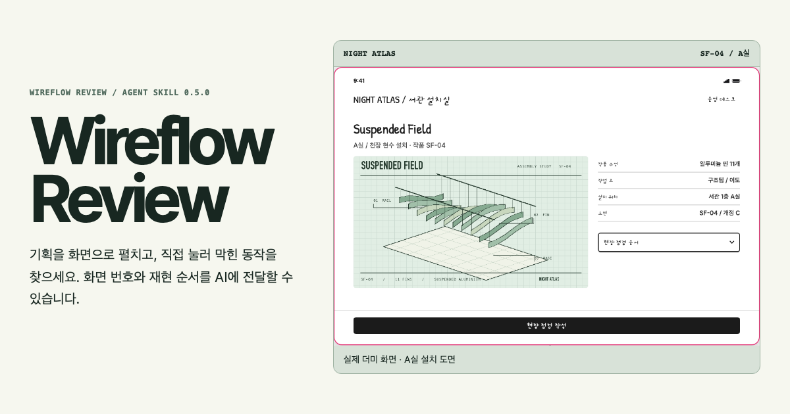

# Wireflow Review

기획 메모나 기존 앱에서 클릭 가능한 와이어프레임을 만드는 AI 스킬입니다. 전체 화면을 한눈에 펼쳐 보고, 사용자가 어디서 멈추는지 직접 재현한 뒤, 화면 번호와 클릭 순서가 담긴 수정 요청을 AI에 전달할 수 있습니다.

## 내 프로젝트에 적용하기

이 저장소 주소를 복사해 **내 프로젝트를 열어 둔 AI 채팅**에 아래 문장과 함께 보내세요.

```text
https://github.com/JeongK7998/wireflow-review
이 스킬을 내 프로젝트에 적용해줘.
```

AI는 [프로젝트 적용 안내](release/APPLY.md)를 따라 설치하고 편집용 흐름 JSON, 브라우저에서 열 수 있는 HTML, 검수 결과를 만듭니다. 직접 설치하려면 [v0.5.0 스킬 ZIP](release/wireflow-review-v0.5.0.zip)을 내려받아 프로젝트의 `.agents/skills/`에 풉니다. 기본 생성에는 Node.js 18 이상이 필요합니다.

## 대표 예제 · Night Atlas



전시팀이 평면도에서 A실을 선택하고, 설치 도면을 대조한 뒤, 다음 교대에 점검 메모를 보냅니다. 여덟 화면 중 한 곳에는 끊긴 연결이 있습니다. ‘보낸 메모 다시 열기’를 눌러 문제를 재현하면, 메모 재열람이 필수라는 점과 별도 기록 화면은 제안이라는 점이 수정 요청에도 남습니다.

- [19초 시연 영상](release/media/night-atlas.mp4) · [한국어 자막](release/media/night-atlas.ko.vtt)
- [클릭 예제 HTML](release/example/night-atlas.html) — GitHub 파일 보기에서 원본 파일을 다운로드한 뒤 브라우저에서 열어 보세요.
- [예제 기획](release/example/brief.md) · [편집용 흐름 JSON](release/example/night-atlas.flow.json) · [검수 화면 캡처](release/media/04-review.png)

[버전별 배포 파일](https://github.com/JeongK7998/wireflow-review/releases)
