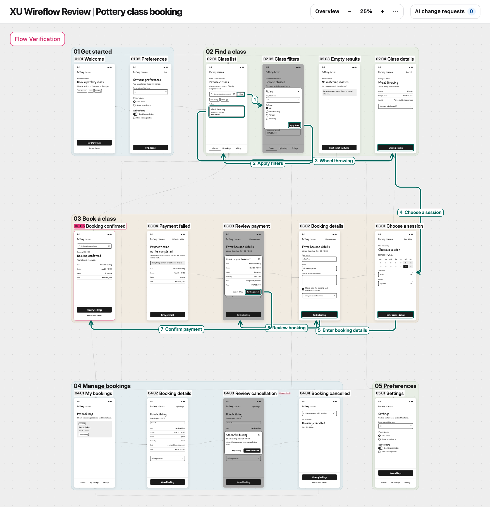
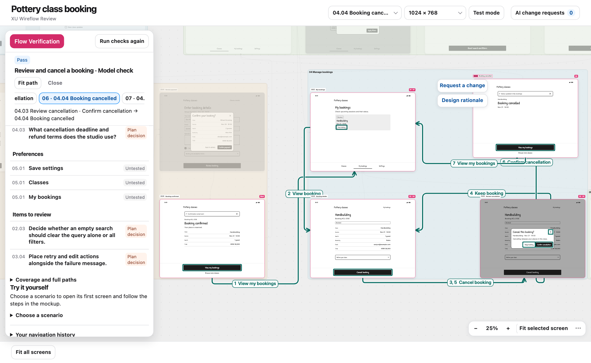

# XU Wireflow Review

[English](README.md) · 한국어

앱을 기획하는 누구나 **화면 구조와 사용자 흐름**을 점검할 수 있는 AI 스킬입니다. 기획 메모나 기존 화면을 바탕으로 단순한 더미 화면들을 화살표로 연결한 와이어플로우를 만듭니다. 시각 디자인을 정하기 전에 버튼을 직접 눌러 보며 화면이 자연스럽게 이어지는지, 빠진 단계는 없는지 확인하세요.

- **앱 전체를 한눈에 봅니다.** 화면을 기능별로 모아 보여줍니다. 경로 하나를 고르면 눌러야 할 버튼과 다음 화면을 잇는 화살표가 순서대로 강조됩니다.
- **놓치기 쉬운 동작을 확인합니다.** 입력 후 뒤로 가거나, 중간에 취소하거나, 실패 후 다시 시도해 보세요. 어느 화면으로 돌아가고 어떤 값이 남는지 확인할 수 있습니다.
- **더미에서 확인한 변경을 개발에 전달합니다.** 프로젝트 채팅이나 연결 미리보기의 화면별 수정 요청으로 와이어플로우를 갱신합니다. 검토한 변경을 골라 앱 개발 채팅에 한 번에 전달할 수 있어요.

## 내 프로젝트에 적용하기

1. AI 코딩 도구에서 프로젝트를 열고 기획 메모나 기존 화면을 준비하세요.
2. 프로젝트 채팅에 아래 두 줄을 붙여 넣으세요.

```text
https://github.com/JeongK7998/wireflow-review
이 스킬을 내 프로젝트에 적용해줘.
```

3. AI가 만든 미리보기에서 한 경로를 눌러 보세요. 변경은 더미에서 먼저 확인하고 **일괄 개발 반영 요청**으로 앱에 적용할 내용을 전달하세요.

배포 키트를 받았다면 프로젝트 채팅에 첨부하고 같은 요청을 보내세요.

[사용 방법](HOW_TO_USE.md#한국어) · [AI용 설치 안내](APPLY.md#한국어)

## 화면에서 살펴보기

**모바일 · 앱 전체에서 한 경로 따라가기.** 번호가 붙은 화살표를 따라가면 어떤 버튼을 눌러 다음 화면으로 가는지 보입니다. 검색 결과가 없거나 작업에 실패하는 화면도 같은 지도에서 찾을 수 있습니다.

[](media/booking-mobile-en.png)

**태블릿 · 두 선택의 결과 비교하기.** 확인창을 닫을 때와 선택을 확정할 때 각각 어디에 도착하는지 살펴보세요. 옆의 검증 패널에서 현재 단계와 아직 정해야 할 질문을 함께 볼 수 있습니다.

[](media/booking-tablet-en.png)

내 프로젝트에 적용하기 전에 직접 눌러 보려면 키트에 들어 있는 예제를 브라우저에서 여세요. [한국어 예제 열기](example/pottery-booking.ko.html)

[스킬 ZIP 내려받기](wireflow-review-v0.7.0.zip)

<details>
<summary>예제별 검증 기록과 배포 파일 목록</summary>

### 도예 공방 예약

기존 공방 예약 더미의 16개 화면·상태를 시작, 수업 탐색, 예약, 예약 관리, 설정으로 묶었다. 날짜, 시간, 인원은 직접 바꿀 수 있다. 한국어와 영어 모두 단일 HTML을 열어 실행한다.

1. 수업 목록에서 지역과 종류를 좁힌다. 수업을 열고 달력에서 날짜를 선택한 뒤 시간과 인원을 바꾼다.
2. 예약자 정보와 동의를 입력한다. 결제 확인에서 이전 화면으로 돌아가 선택값과 입력값이 남는지 본다. 결제 실패를 재현한 뒤 재시도해 금액과 일정을 대조한다.
3. 내 예약에서 취소 확인창을 닫아 예약을 유지한다. 다시 열어 취소를 확정하고 목록에서 상태를 확인한다. 취소 가능 시점과 환불 문구는 정책 질문으로 남아 있다.

배포 키트의 루트에 설치 ZIP을 풀면 아래 명령으로 예제를 검사하고 다시 생성할 수 있다.

```sh
node wireflow-review/scripts/wireflow.cjs check example/pottery-booking.ko.flow.json
node wireflow-review/scripts/wireflow.cjs build example/pottery-booking.ko.flow.json example/rebuilt.html
```

### 도면 기반 예제 · Night Atlas

[클릭 더미](example/night-atlas.html)에서 A실 도면을 열고 메모를 작성한 뒤 인계한다. 보낸 메모를 다시 여는 연결이 끊긴다. 검증 패널에서 필수 동작과 미확정 설계를 비교하고, 별도 기록 화면을 선택한 뒤 메모가 유지되는지 확인할 수 있다. [전시 기획](example/brief.md) · [흐름 JSON](example/night-atlas.flow.json)

### 확인한 범위

공방 예약 예제는 한국어·영어 각각 Chromium에서 기본 조작 78개와 모델의 화면 연결 39개를 확인했다. 테스트 모드에서는 취소창을 닫을 때의 복귀 오류와 취소 확정 뒤 예약 상태 오류를 두 언어에서 검출했다.

v0.5.2의 경로 표시를 21개 샘플 버전에서 Chromium 창 너비 390px와 1440px로 확인했다. 총 116회 경로를 선택해 그룹 위치, 전환 방향, 끊긴 연결 표시를 대조했다. 도예 공방처럼 화면이 많은 예제도 포함한다.

이전 버전에서는 별도 Codex 세션에 저장소 링크와 적용 요청 한 줄을 주고, 상영관 기획에서 네 화면을 생성하는 것까지 확인했다.

Night Atlas의 실제 브라우저 조작에서는 입력이 빠진 두 경우, 전송 전 메모 수정, 전송 뒤 재열람 실패와 요청 복사를 확인했다. 별도 기록 화면을 더미에서 선택한 뒤 수정한 메모가 그대로 보였다. 검수 패널의 관찰 요건 7개, 전체 여정 2개, 예외 여정 1개가 통과했다. 영상은 1600×1000 Chromium 창에서 녹화했다.

### 게시와 미디어

GitHub 저장소 첫 화면에 소개, 시연 영상과 예제를 담은 README를 둔다. 설치 ZIP은 저장소에서 내려받을 수 있고, 버전을 발행할 때 같은 ZIP과 전체 배포 키트를 GitHub Releases에 첨부할 수 있다. 클릭 더미는 HTML 원본을 내려받아 브라우저에서 연다. 전체 키트에는 [오프라인 미리보기](index.html)도 들어 있다.

| 용도 | 리소스 |
|---|---|
| Night Atlas 도면 상세 | [설치 도면 PNG](media/installation-detail.png) |
| Night Atlas 브라우저 캡처 | [전체 캔버스](media/01-canvas.png) · [평면도](media/02-floor-plan.png) · [입체 도면](media/03-installation.png) · [검증 패널](media/04-review.png) · [수정 요청](media/05-handoff.png) |
| Night Atlas 실제 조작 시연 | [무음 H.264 MP4](media/night-atlas.mp4) · [한국어 WebVTT 자막](media/night-atlas.ko.vtt) |
| 무결성 | [SHA-256 체크섬](SHA256SUMS) |

예제 도면과 영상은 가상 전시를 위해 제작한 그림과 실제 더미 조작 녹화다. 폰트는 Inter, Patrick Hand, Gaegu, Noto Sans KR을 사용하며 각 OFL 고지는 설치 ZIP의 `assets/paper/fonts/`와 생성된 HTML의 스타일에 포함된다. 스킬 코드와 홍보물의 공개 재배포 라이선스는 제작자가 정할 항목이다.

</details>
