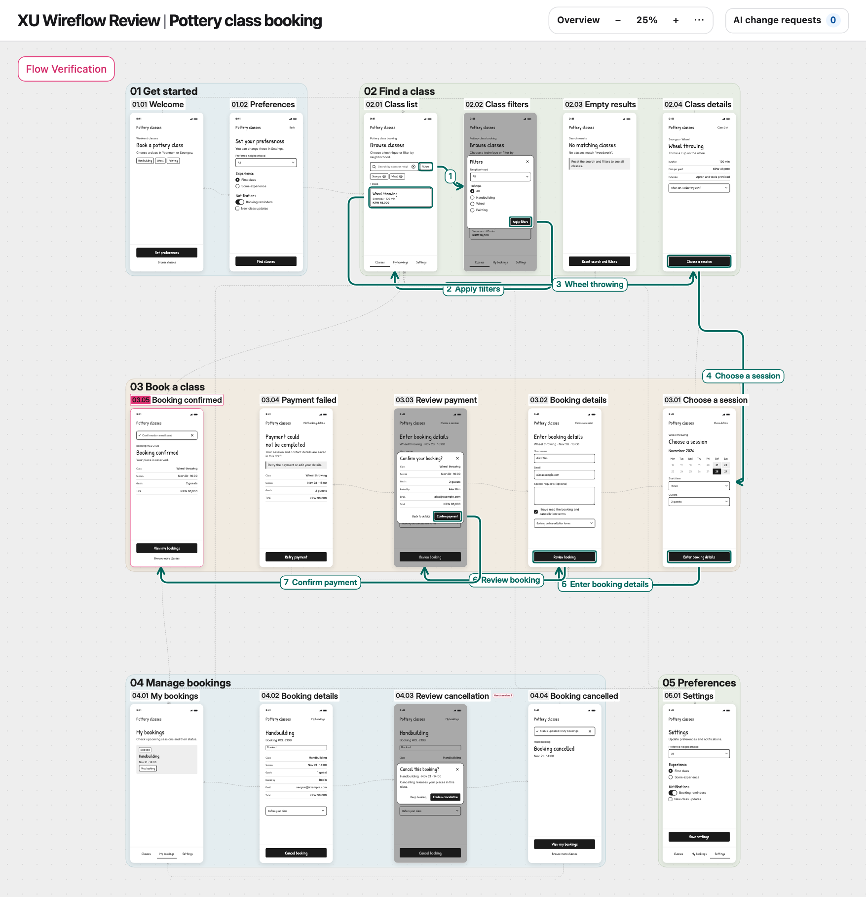
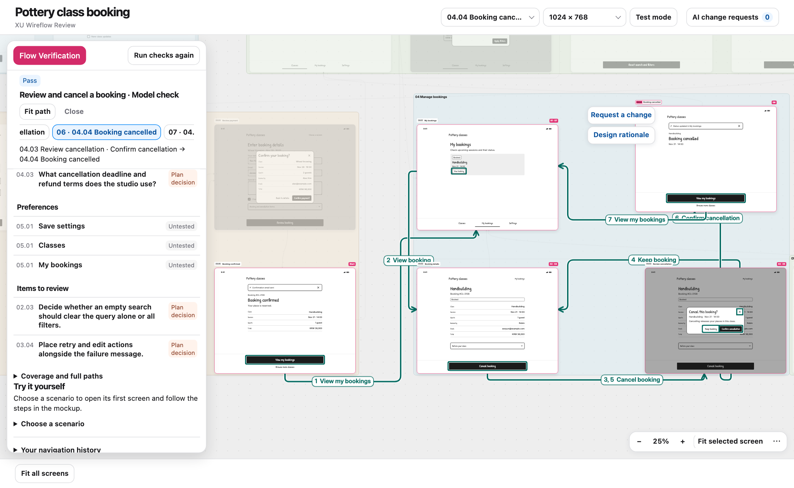

# XU Wireflow Review

English · [한국어](README.ko.md)

This AI skill helps anyone planning an app review its **structure and user flow** before choosing a visual design. It turns your notes or existing screens into a clickable wireflow of simple mock screens connected by arrows. Click through a task to see where each choice leads and spot any missing steps.

- **See the whole app.** Screens are grouped by task. Pick a path to highlight the buttons and numbered arrows that take someone from start to finish.
- **Try the easy-to-miss steps.** Go back after entering information, cancel halfway through, or retry after an error. Check where you land and what the app remembers.
- **Review changes before implementation.** Update the Wireflow from your project chat or from a screen in a connected preview. Send the changes you approve to your app development chat in one batch.

## Use it in your project

1. Open your project in an AI coding tool with your notes or existing screens.
2. Paste these two lines into the project chat.

```text
https://github.com/JeongK7998/wireflow-review
Apply this skill to my project.
```

3. Open the preview your AI creates and follow one highlighted path. Try a change, review it in the mockup, then use **Request development changes in bulk** to prepare the implementation request.

If you have the distribution kit, attach it to the project chat and send the same request.

[How to use](HOW_TO_USE.md#english) · [AI setup guide](APPLY.md)

## A closer look

**Mobile · Follow one path across the whole app.** The numbered arrows show which button leads to the next screen. Nearby screens show where empty results or failures fit into the same flow.

[](media/booking-mobile-en.png)

**Tablet · Compare two outcomes.** Trace what happens when someone backs out of an action and when they confirm it. The review panel shows the step under inspection and decisions that still need an answer.

[](media/booking-tablet-en.png)

To try it first, open the included demo in a browser. [Open the English demo](example/pottery-booking.en.html)

[Download the skill ZIP](wireflow-review-v0.7.0.zip)
